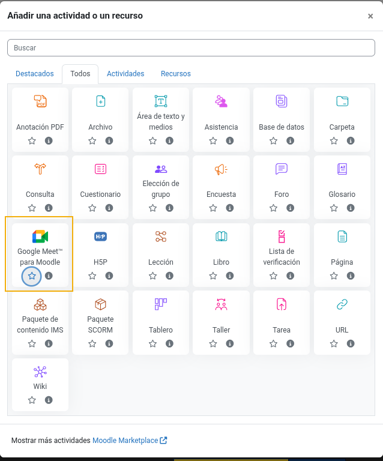
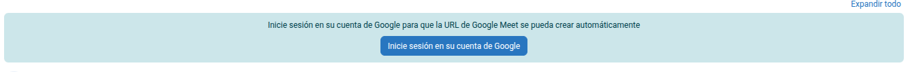
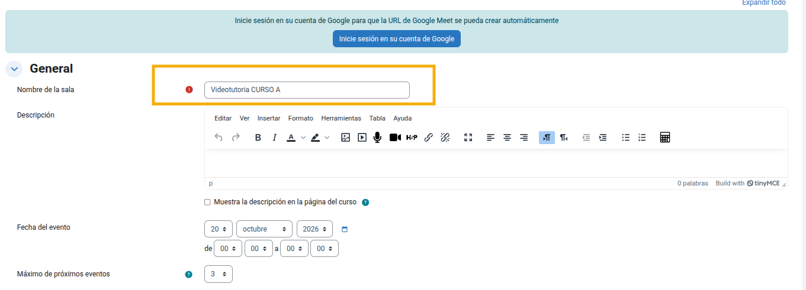
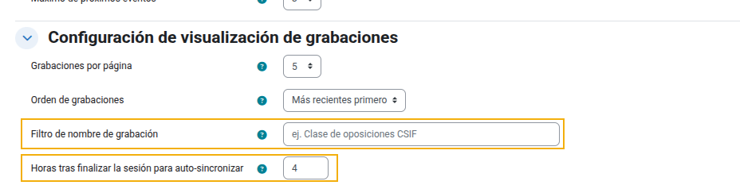
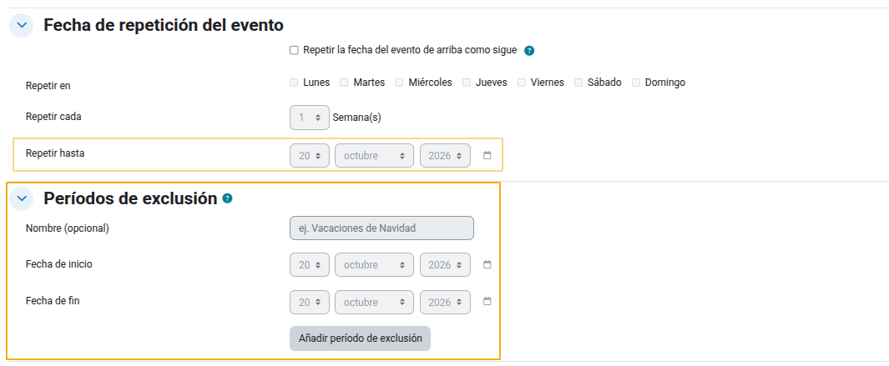
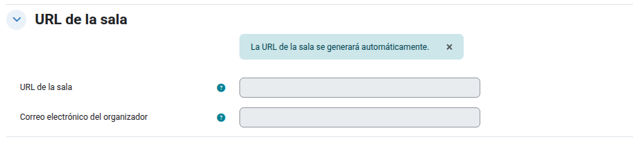
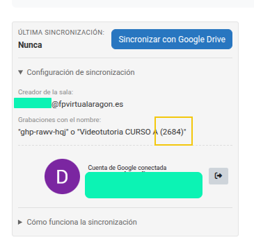

# Guía de usuario — «Videotutoría» (Google Meet para Moodle)
- [Guía de usuario — «Videotutoría» (Google Meet para Moodle)](#guía-de-usuario--videotutoría-google-meet-para-moodle)
  - [1. Crear una videotutoría (profesorado)](#1-crear-una-videotutoría-profesorado)
    - [1.1 Añadir la actividad](#11-añadir-la-actividad)
    - [1.2 Conectar la cuenta de Google](#12-conectar-la-cuenta-de-google)
    - [1.3 Sección «General»](#13-sección-general)
    - [1.4 Configuración de visualización de grabaciones](#14-configuración-de-visualización-de-grabaciones)
    - [1.5 Recurrencia: clases periódicas](#15-recurrencia-clases-periódicas)
    - [1.6 URL de la sala](#16-url-de-la-sala)
    - [1.7 Notificación a estudiantes](#17-notificación-a-estudiantes)
    - [1.8 Adjuntos](#18-adjuntos)
  - [2. La página de la actividad](#2-la-página-de-la-actividad)
    - [Suscripción a avisos de nuevas grabaciones](#suscripción-a-avisos-de-nuevas-grabaciones)
    - [Progreso de visionado](#progreso-de-visionado)
  - [3. Grabar, sincronizar y gestionar las clases](#3-grabar-sincronizar-y-gestionar-las-clases)
    - [3.1 Grabar en Google Meet](#31-grabar-en-google-meet)
    - [3.2 Qué filtros utiliza el sistema al sincronizar](#32-qué-filtros-utiliza-el-sistema-al-sincronizar)
      - [Ejemplo concreto](#ejemplo-concreto)
    - [3.3 Sincronizar con Moodle](#33-sincronizar-con-moodle)
    - [3.4 Qué puede hacer que una videotutoría no sincronice](#34-qué-puede-hacer-que-una-videotutoría-no-sincronice)
      - [Cambiar el nombre de la sala después de sincronizar - SE RECOMIENDA NO HACER NUNCA -](#cambiar-el-nombre-de-la-sala-después-de-sincronizar---se-recomienda-no-hacer-nunca--)
    - [3.5 Gestionar las grabaciones (profesorado)](#35-gestionar-las-grabaciones-profesorado)
    - [3.6 Renombrar una grabación: ¿en Moodle o en Drive?](#36-renombrar-una-grabación-en-moodle-o-en-drive)
    - [3.7 La papelera de grabaciones](#37-la-papelera-de-grabaciones)
    - [3.8 Acceso a las grabaciones en Drive](#38-acceso-a-las-grabaciones-en-drive)
  - [4. El hub de la lección (página de cada grabación)](#4-el-hub-de-la-lección-página-de-cada-grabación)
  - [5. Análisis con IA (Gemini)](#5-análisis-con-ia-gemini)
    - [Cómo generarlo](#cómo-generarlo)
    - [Edición manual](#edición-manual)
  - [6. Preguntas de práctica con IA](#6-preguntas-de-práctica-con-ia)
  - [7. Materiales de la lección](#7-materiales-de-la-lección)
  - [8. Resumen rápido por rol](#8-resumen-rápido-por-rol)
  - [9. Solución de problemas](#9-solución-de-problemas)

Esta guía explica cómo usar la actividad **Google Meet™ para Moodle** (en la plataforma aparece como **«Videotutoría»**) tanto para el profesorado como para el alumnado. La actividad permite crear salas de Google Meet desde el curso, programar sesiones recurrentes, grabar las clases y ponerlas a disposición del alumnado con resúmenes, transcripciones y preguntas de práctica generadas con IA.

## 1. Crear una videotutoría (profesorado)

### 1.1 Añadir la actividad

1. Activa el **modo de edición** en la página del curso.
2. Pulsa **«Añadir una actividad o un recurso»**.
3. Selecciona **«Google Meet™ para Moodle»** (puede estar marcada con una estrella como favorita) y pulsa *Añadir*.

### 1.2 Conectar la cuenta de Google

En la parte superior del formulario verás un aviso azul. Para que la URL de la sala se genere automáticamente, pulsa **«Inicie sesión en su cuenta de Google»** y autoriza el acceso con la cuenta que actuará como organizadora de las sesiones.

> Si no inicias sesión, tendrás que pegar la URL de la sala manualmente en el apartado «URL de la sala».

### 1.3 Sección «General»

- **Nombre de la sala**: es el título de la actividad y el nombre con el que se buscarán las grabaciones en Google Drive (salvo que uses el *filtro de nombre*, ver 1.4). Usa un nombre claro, por ejemplo `Videotutoría CURSO A`.
- **Descripción**: texto opcional que puede mostrarse en la página del curso.
- **Fecha del evento**: día y hora de inicio y fin de la sesión.
- **Máximo de próximos eventos**: cuántas sesiones futuras se muestran en la página de la actividad.

### 1.4 Configuración de visualización de grabaciones

- **Grabaciones por página**: número de grabaciones visibles antes de paginar.
- **Orden de grabaciones**: mostrar primero las más recientes o las más antiguas.
- **Filtro de nombre de grabación**: texto adicional que, si aparece en el nombre del archivo de Drive, hará que la sincronización lo asocie a esta actividad, aunque no coincida con su nombre. Útil cuando el nombre de la grabación en Drive no coincide con el nombre de la actividad. Ten en cuenta que es un criterio **añadido**: no restringe el emparejado por nombre de actividad, código de reunión ni carpeta asignada (ver 3.2).
- **Horas tras finalizar la sesión para auto-sincronizar**: la actividad se sincronizará sola con Drive al cabo de ese tiempo tras cada sesión. Pon `0` para desactivarlo y sincronizar siempre a mano.

### 1.5 Recurrencia: clases periódicas

Marca **«Repetir la fecha de la sesión de arriba como sigue»** para programar una serie de clases:

- **Repetir en**: días de la semana en que se imparte (p. ej. lunes y miércoles).
- **Repetir cada**: frecuencia en semanas (`1` = cada semana, `2` = cada dos semanas…).
- **Repetir hasta**: último día de la serie. **Importante**: cuando las clases terminen, ajusta esta fecha al pasado para cerrar la recurrencia.

**Períodos de exclusión**: define rangos de fechas en los que no se programan sesiones (vacaciones de Navidad, Semana Santa…). Los eventos que caigan dentro se omiten.

**Sesiones canceladas**: marca fechas concretas como canceladas (festivos, enfermedad…). Aparecerán en la página con la indicación «Cancelada» en lugar de desaparecer.

### 1.6 URL de la sala

Si iniciaste sesión con Google, la URL se genera automáticamente al guardar y no hay que escribir nada. También se muestra el **correo del organizador**.

> **¡Atención!** Si cambias la URL de la sala o el correo del organizador después de haber sincronizado grabaciones, esas grabaciones pueden acabar movidas a la papelera en la siguiente sincronización (ver 3.4).

### 1.7 Notificación a estudiantes

En la sección **«Recordatorio de clase»** puedes activar el envío de un aviso a los estudiantes matriculados, configurando cuántos **minutos antes** del inicio se envía.

### 1.8 Adjuntos

En **«Adjuntos»** puedes subir archivos (PDF, diapositivas, documentos…) que el alumnado verá como lista de descarga en la página de la actividad.

## 2. La página de la actividad

La página de la videotutoría muestra:

- **Hero principal**: botón para entrar en la sala. Para el profesorado aparece además «Preparar sala · Entrar» antes de que empiece la clase. Durante la sesión se muestra el estado **«EN DIRECTO»** y un contador de tiempo.
- **Próximas clases**: las sesiones programadas con su cuenta atrás (*«Comienza en…»*, *«Comenzó hace…»*). Las sesiones canceladas aparecen marcadas.
- **Horario de clases**: el calendario completo de la serie.
- **Lecciones (grabaciones)**: las clases grabadas, con buscador y filtros por temas. Se pueden ver como **tarjetas** o como **lista**.

### Suscripción a avisos de nuevas grabaciones

Profesorado y alumnado pueden activar **«Recibir avisos»** para que el sistema envíe un correo (y un mensaje en la plataforma) cada vez que haya una grabación nueva.

### Progreso de visionado

El sistema registra el visionado de cada grabación (no vista / parcial / vista). El alumnado dispone de un botón **«Continuar viendo»** que le lleva directamente a su lección pendiente.

## 3. Grabar, sincronizar y gestionar las clases

### 3.1 Grabar en Google Meet

Las grabaciones se guardan automáticamente en **«Mi unidad → Meet Recordings»** del Drive del organizador. Para poder grabar:

- La cuenta del organizador no debe haber agotado su cuota personal de Drive.
- La organización (Google Workspace) debe tener cuota disponible.

### 3.2 Qué filtros utiliza el sistema al sincronizar

Al sincronizar, el sistema aplica **dos filtros** sobre los vídeos (MP4) del Google Drive del organizador. Basta con que una grabación pase **uno solo** de los dos filtros para asociarse a la actividad:

**Filtro 1 — por nombre de archivo** (sin distinguir mayúsculas). Se acepta el vídeo si su nombre contiene **alguno** de estos textos:

- el **código de la reunión**: las tres grupos de letras de la URL de la sala (p. ej. `abc-defg-hij`);
- el **nombre de la actividad**: al inicio del nombre del archivo, o seguido de `(` o `-`;
- el **filtro de nombre personalizado**, si lo configuraste (ver 1.4). Es un criterio *añadido*: amplía el emparejado, no lo restringe.

**Filtro 2 — por carpeta de Drive asignada**. En la primera sincronización, el sistema «recuerda» la carpeta de Drive de cada grabación (su *huella de carpeta*). A partir de entonces, **todo vídeo que aparezca dentro de esas carpetas se considera de esta actividad aunque se haya renombrado** el archivo, la actividad o la reunión. Es la regla principal y la que hace que los renombres no rompan nada.

#### Ejemplo concreto

Supón esta videotutoría:

- **Nombre de la actividad en Moodle**: `Videotutoría CURSO A`
- **URL de la sala**: `https://meet.google.com/abc-defg-hij` → código de reunión: `abc-defg-hij`
- **Archivo que aparece en Drive** tras la clase, dentro de `Mi unidad → Meet Recordings`:
  `Videotutoría CURSO A (4821) - 2026/10/20 10:00 GMT+2.mp4`

Al sincronizar:

1. **Filtro 1 (nombre)**: el archivo contiene el texto `Videotutoría CURSO A` al inicio del nombre → **empareja** (aunque no contenga el código `abc-defg-hij`, basta un criterio).
2. Al importarse, el sistema guarda además la carpeta de Drive donde estaba el archivo (la «huella»).
3. A partir de ese momento, aunque renombres la actividad, la reunión o el archivo, la grabación seguirá encontrándose por el **Filtro 2 (carpeta)**.

Contrapartida: si en Google Calendar renombraras el evento de la clase como `Repaso intensivo`, el archivo resultante sería `Repaso intensivo - 2026/10/20 10:00 GMT+2.mp4`. Ese nombre no contiene ni el código ni el nombre de la actividad, así que **no emparejaría**… salvo que:

- pongas `Repaso intensivo` como **filtro de nombre personalizado** de la actividad, o
- la grabación caiga dentro de una carpeta ya asignada a esta actividad (Filtro 2).

Otras reglas del emparejado:

- Una grabación ya asociada a **otra** videotutoría nunca se importa aquí.
- Si hay **dos actividades con el mismo nombre** (mismo profesor), la grabación se asigna a la videotutoría cuya franja horaria programada coincide con la hora de inicio real de la sesión (que se lee del nombre del archivo); si hay empate, gana la franja más cercana.
- Google Drive es la **fuente de verdad**: una grabación desaparece de Moodle (va a la papelera, ver 3.7) solo cuando su archivo ya no aparece en ninguno de los dos filtros.

### 3.3 Sincronizar con Moodle

Tras la clase, espera **al menos 10 minutos** a que Google procese el archivo y luego pulsa **«Sincronizar con Google Drive»** en la página de la actividad. Al terminar, el sistema informa del resultado: grabaciones nuevas, actualizadas, movidas a la papelera, restauradas o «ya estaban actualizadas».

En el panel de sincronización verás el **organizador**, el nombre con el que se buscan las grabaciones —el de la actividad o el código de la sala (p. ej. `abc-defg-hij` o `Videotutoría CURSO A (1234)`— y la **última sincronización**.

> Si la cuenta de Google caduca o se revoca el acceso, vuelve a iniciar sesión desde el formulario de edición de la actividad.

También puedes dejar que la sincronización ocurra sola activando el **auto-sincronizado** (ver 1.4): al cabo de las horas configuradas tras cada sesión, la tarea programada del servidor sincroniza la actividad (con reintentos acotados si hay fallos temporales).

### 3.4 Qué puede hacer que una videotutoría no sincronice

Estas son las causas habituales de que una grabación no aparezca (o de que una sincronización «no haga nada»):

| Causa | Qué hacer |
| --- | --- |
| **No has iniciado sesión con Google** o la sesión caducó/se revocó | Inicia sesión de nuevo desde el formulario de edición de la actividad. |
| **Han pasado menos de ~10 minutos** desde el fin de la clase | Google aún está procesando el vídeo; espera y vuelve a sincronizar. |
| **El nombre del archivo no coincide con ningún criterio** y su carpeta no está asignada a la actividad | Comprueba el nombre en Drive; usa el *filtro de nombre personalizado* (1.4) si difiere del de la actividad. |
| **La carpeta de Drive está asignada a otra videotutoría** | Usa «Mover a…» en la otra actividad para reasignarla. |
| **La grabación se asignó a otra videotutoría con el mismo nombre** | Revisa ambas actividades; si hace falta, mueve la grabación. |
| **No se pudo grabar en Meet** (cuota personal u organizativa de Drive agotada) | Libera espacio y vuelve a grabar; sin archivo en Drive no hay nada que sincronizar. |
| **Auto-sincronización desactivada** (`0` horas) o **intentos agotados** tras fallos repetidos | Sincroniza manualmente con el botón. |
| **Otra sincronización está en curso** | Espera unos minutos e inténtalo de nuevo. |

#### Cambiar el nombre de la sala después de sincronizar - SE RECOMIENDA NO HACER NUNCA -

- **Renombrar la actividad en Moodle es seguro**: las grabaciones ya sincronizadas están ancladas por su carpeta de Drive (Filtro 2 de 3.2), así que no se pierden; las grabaciones futuras usarán el nuevo nombre, porque el evento de calendario se actualiza en Google y el código de la reunión no cambia. No hace falta hacer nada más.

  Sobre las carpetas de Drive: Google organiza las grabaciones en `Meet Recordings` con **una subcarpeta por título de reunión**. Al renombrar la actividad, nada se mueve: las grabaciones antiguas siguen en la subcarpeta vieja y las nuevas caerán, normalmente, en una **subcarpeta nueva** con el título nuevo. El plugin lo gestiona solo: cada grabación guarda su carpeta y todas las carpetas de las grabaciones de una actividad quedan asignadas a ella (puede tener varias), así que en la siguiente sincronización la carpeta nueva se añade a la videotutoría y todo se sigue mostrando junto.
- **En cambio, cambiar la URL de la sala o el correo del organizador es bastante arriesgado**: la sincronización busca entonces un código de reunión distinto y/o en la cuenta de Drive de otra persona, las grabaciones anteriores dejan de aparecer en el resultado y el sistema las trata como desaparecidas → **las mueve a la papelera** (borrado suave, reversible). Si esto te ha pasado, **revierte el cambio** (URL y correo originales) y sincroniza de nuevo: las grabaciones se restauran automáticamente desde la papelera.

### 3.5 Gestionar las grabaciones (profesorado)

En cada grabación, el profesorado puede:

- **Renombrar**: cambia el título en Moodle sin tocar el archivo de Drive (ver 3.6).
- **Ocultar / Mostrar a alumnos**: controla la visibilidad sin borrar nada.
- **Mover a…**: reasigna una grabación a otra sala de Meet; las futuras grabaciones de la misma carpeta de Drive seguirán esa asignación.
- **Abrir en Drive**: acceso directo al archivo.
- **Eliminar**: mueve la grabación a la papelera (ver 3.7).

### 3.6 Renombrar una grabación: ¿en Moodle o en Drive?

El plugin guarda internamente **dos nombres** por grabación:

- el **nombre en Moodle** (el título que ves en la plataforma), y
- el **último nombre de archivo visto en Drive** durante la sincronización.

Gracias a eso, las sincronizaciones **nunca sobrescriben un título que personalizaste en Moodle**. Las reglas son:

**Si renombras la grabación en Moodle** (botón «Renombrar grabación»):

- Tu nombre personalizado se queda fijo: ninguna sincronización futura lo cambiará, **aunque el archivo se renombre luego en Drive**.
- El archivo en Google Drive **no se toca**: sigue teniendo su nombre original. El renombrado solo afecta al aula.
- El resto de datos (enlace, duración, fecha) siguen actualizándose con Drive.

**Si renombras el archivo en Google Drive -NO RECOMENDADO-**(y luego sincronizas):

- Si el título en Moodle era el **original auto-importado** (nunca lo personalizaste): el cambio se propaga y Moodle muestra el nuevo nombre de Drive.
- Si habías **personalizado el título en Moodle**: Moodle conserva tu título; internamente solo se anota el nuevo nombre de Drive. Tu nombre siempre gana.

> **Grabaciones antiguas**: las filas creadas antes de que existiera este mecanismo se protegen igual: en la primera sincronización tras la actualización, el sistema anota el nombre actual de Drive y conserva el título que hubiera en Moodle, por si ya lo habías personalizado.

En resumen:

| Dónde renombras | ¿Qué nombre gana en Moodle? | ¿Se toca Drive? |
| --- | --- | --- |
| En Moodle (plugin) | Tu nombre personalizado, para siempre | No |
| En Drive, sin personalizar antes en Moodle | El nuevo nombre de Drive | — |
| En Drive, con título ya personalizado en Moodle | Tu nombre personalizado de Moodle | — |

### 3.7 La papelera de grabaciones

**Nada se borra definitivamente a la primera.** Toda eliminación del plugin es un *borrado suave*: la fila se marca como eliminada junto con la fecha, pero su contenido asociado —visibilidad, progreso de visionado del alumnado, materiales adjuntos y análisis IA— queda intacto y recuperable.

Una grabación llega a la papelera de dos formas:

1. **Manual**: con el botón «Eliminar» de la grabación, o con la acción de papelera masiva («eliminar todas»), que envía todas las grabaciones activas a la papelera de una vez.
2. **Por la sincronización**: cuando el archivo deja de existir en Google Drive para esta actividad (se borró en Drive, o la URL/organizador cambiaron, ver 3.4), la siguiente sincronización mueve la fila a la papelera e informa de ello en el resumen («N grabación(es) movida(s) a la papelera»).

En la vista **«Papelera (N)»** verás cada elemento con su fecha de grabación y de eliminación, y dos acciones:

- **Restaurar**: la grabación vuelve a la lista activa con todo lo que tenía. También se restaura sola si el archivo reaparece en Drive y sincronizas.
- **Eliminar definitivamente**: es la **única acción irreversible**. Solo está disponible sobre grabaciones ya en la papelera y borra también su análisis IA y sus materiales adjuntos. La acción queda registrada en el registro de la actividad.

> **Importante**: ni la papelera ni «eliminar definitivamente» tocan el archivo en Google Drive. El archivo de Drive solo desaparece si lo borras tú en Drive (y entonces la siguiente sincronización enviará la fila a la papelera). Al revés: si quieres quitar una grabación del aula, basta con «Eliminar» en Moodle; no hace falta tocar Drive.

### 3.8 Acceso a las grabaciones en Drive

El administrador del sitio configura quién puede abrir las grabaciones mediante el enlace de Drive:

- **Privado**: solo la cuenta propietaria.
- **Miembros de la organización del propietario**: cualquier cuenta del mismo dominio de Google Workspace puede verla (recomendado para centros con Workspace).
- **Cualquier persona con el enlace**: acceso público de lectura.

Este ajuste afecta a quién puede *reproducir* la grabación incrustada; no afecta a la sincronización.

## 4. El hub de la lección (página de cada grabación)

Al abrir una grabación accedes a su página con varias pestañas:

| Pestaña | Contenido |
| --- | --- |
| **Resumen** | Vídeo incrustado, resumen de la clase, puntos clave, temas y **capítulos** con marcas temporales. |
| **Preguntas** | Preguntas de práctica publicadas para repasar la clase. |
| **Transcripción** | Transcripción completa de la sesión (con botón *Copiar*; solo visible para el profesorado y usuarios con permiso de edición). |
| **Materiales** | Archivos descargables asociados a esa lección. |
| **Notas** | Notas de la reunión generadas por Gemini. |

En la parte superior hay navegación **«Anterior / Siguiente»** para moverte entre lecciones y un enlace **«Volver a lecciones»**.

## 5. Análisis con IA (Gemini)

Si el sitio tiene habilitada la IA (configuración del administrador), el profesorado puede generar automáticamente para cada grabación:

- **Resumen** de la clase.
- **Puntos clave**.
- **Temas** tratados (sirven además para filtrar las lecciones).
- **Transcripción** extraída de los subtítulos automáticos de la grabación.
- **Capítulos** con marcas temporales.

### Cómo generarlo

1. Abre la grabación y pulsa **«Generar análisis IA»** (o actívalo para que se genere automáticamente con cada sincronización).
2. El proceso se ejecuta en segundo plano; la página se actualiza al terminar.
3. Si no hay subtítulos automáticos disponibles, puedes usar **«Transcribir desde vídeo»**, que descarga el vídeo completo y genera la transcripción a partir del audio (puede tardar varios minutos).

### Edición manual

En cualquier momento el profesorado puede pulsar **«Editar análisis»** para corregir o escribir a mano el resumen, los puntos clave, los temas o la transcripción.

## 6. Preguntas de práctica con IA

Desde la pestaña **«Preguntas»** de una lección, el profesorado puede generar cuestionarios a partir de la transcripción:

1. Pulsa **«Generar preguntas con IA»**.
2. Las preguntas se crean como **borradores** en el banco de preguntas de Moodle (en la categoría «Google Meet: *nombre de la actividad*»), marcadas como *«Generado con IA, pendiente de revisión»*.
3. Revisa cada borrador: puedes **publicarla** (los estudiantes la verán como práctica), **editarla** (con edición avanzada en el banco de preguntas) o **descartarla**. También hay acciones en lote.

Los estudiantes, desde la pestaña «Preguntas» de una lección con preguntas publicadas, pueden hacer un **test de práctica**: responden, comprueban cada respuesta con su explicación y referencia a la transcripción, y pueden reintentar.

## 7. Materiales de la lección

El profesorado puede adjuntar archivos a cada grabación (apartado **«Materiales»** de su página). El alumnado los ve como una lista de descarga junto al vídeo. Además, la actividad permite subir **adjuntos generales** (sección «Adjuntos» del formulario) visibles para todo el alumnado en la página principal.

## 8. Resumen rápido por rol

**Profesorado**

1. Crear la actividad «Videotutoría» e iniciar sesión con la cuenta de Google organizadora.
2. Nombrar la sala, configurar fecha y recurrencia, y guardar (se crea la URL y el evento de calendario).
3. Dar clase y grabar en Meet.
4. Esperar ~10 minutos y **sincronizar con Google Drive**.
5. Revisar el análisis IA, los capítulos y publicar las preguntas de práctica.
6. Gestionar grabaciones: renombrar (en Moodle, sin miedo a que se pierda), ocultar, mover o eliminar (a la papelera).

**Alumnado**

1. Recibir el recordatorio antes de la clase (si está activado) y entrar desde la página de la actividad.
2. Tras la sesión, suscribirse a avisos para saber cuándo está la grabación.
3. Ver las lecciones, filtrar por temas, usar «Continuar viendo» y consultar resúmenes, capítulos, materiales y preguntas de práctica.

## 9. Solución de problemas

| Problema | Solución |
| --- | --- |
| No se genera la URL de la sala | Inicia sesión con la cuenta de Google desde el formulario de edición; si el aviso persiste, pega la URL manualmente. |
| La grabación no aparece tras sincronizar | Revisa las causas de 3.4: espera 10 minutos, comprueba el nombre en Drive, el filtro personalizado, la sesión de Google y la cuota. |
| No se pudo grabar en Meet | Comprueba la cuota personal de Drive y la de la organización. |
| Las grabaciones desaparecieron de la lista | Casi seguro cambiaron la URL de la sala o el correo del organizador: revierte el cambio y sincroniza; se restauran desde la papelera. También puedes restaurarlas a mano desde «Papelera». |
| Renombré una grabación y la sincronización le ha cambiado el nombre | No debería pasar: el nombre personalizado en Moodle siempre gana (ver 3.6). Si ocurrió en una grabación muy antigua, vuelve a renombrarla. |
| El alumno no puede reproducir el vídeo incrustado | Depende del modo de acceso configurado (3.8): con «Privado» solo la cuenta propietaria puede verlo; usa «Miembros de la organización» o «Cualquier persona con el enlace». |
| «Análisis IA no disponible» | La IA puede no estar habilitada en el sitio o haber fallado; reintenta con «Regenerar» o usa «Transcribir desde vídeo». |
| Quiero quitar una grabación del aula | Usa «Eliminar»: irá a la papelera sin tocar el archivo de Drive y podrás restaurarla. |
